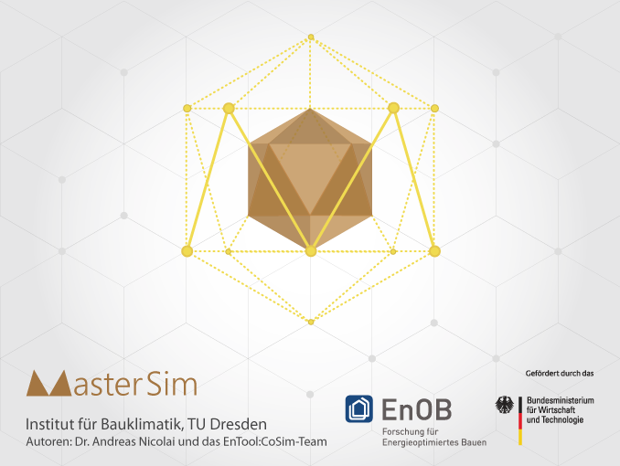
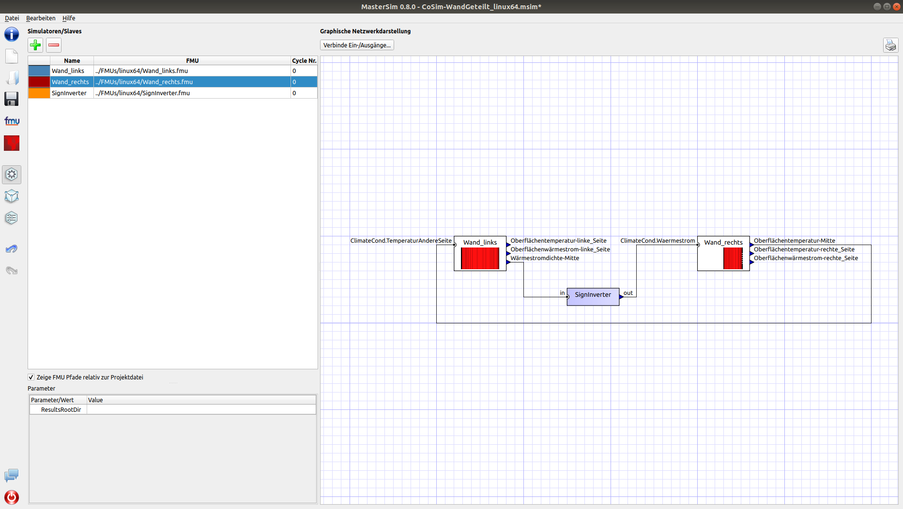
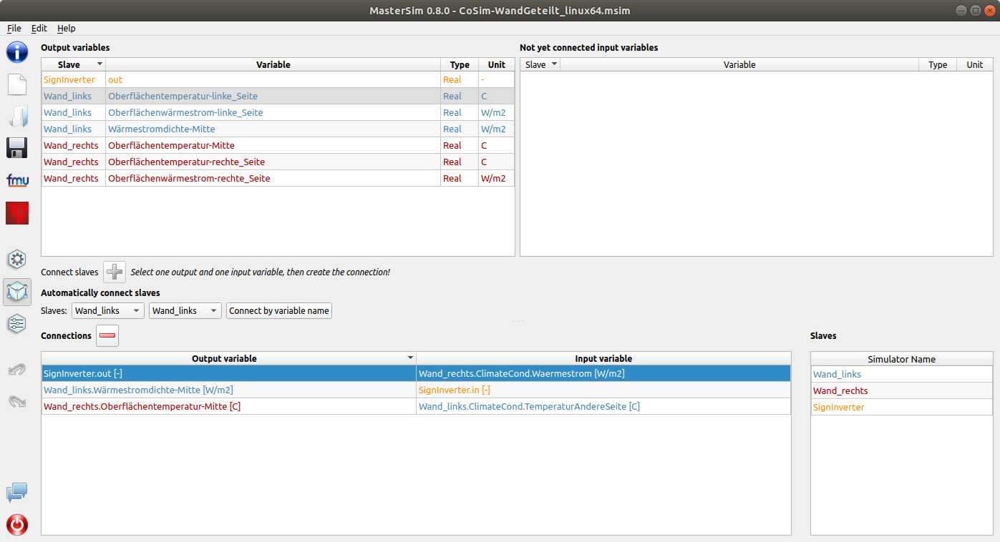
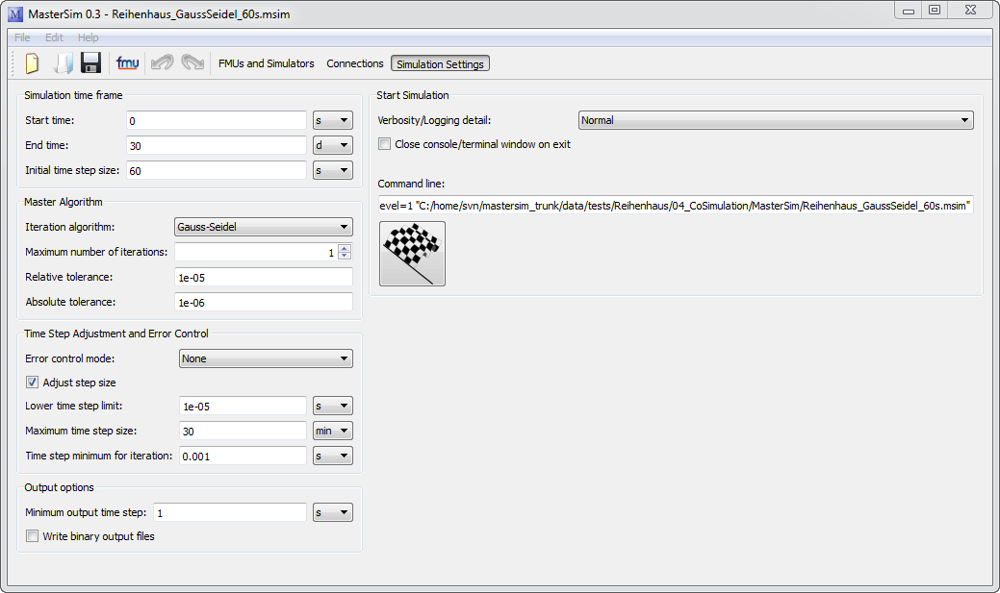
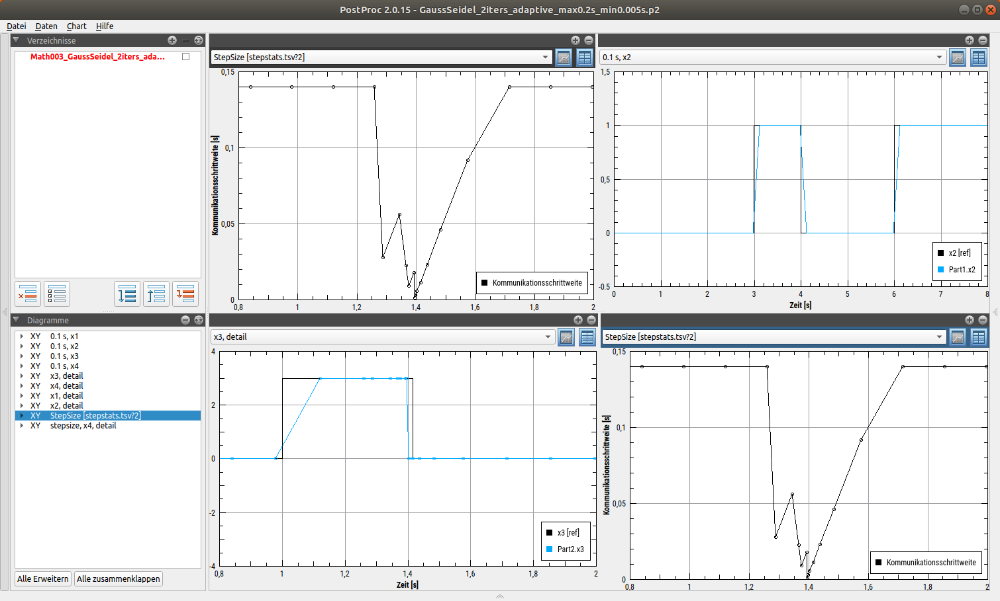
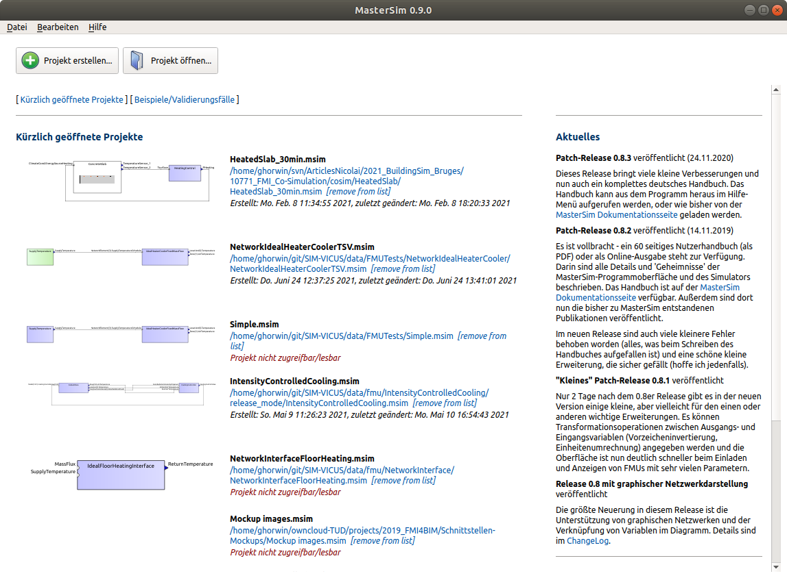

# About MasterSim ...

_MasterSim_ is an FMI ([_Functional Mock-Up Interface_](https://fmi-standard.org)) Co-Simulation master and programming library. It supports the 
Functional Mock-Up Interface for Co-Simulation in Version 1.0 and 2.0. Using the functionality of 
version 2.0, it implements various iteration algorithms that rollback FMU slaves and increase stability of coupled simulations.



_MasterSim_ is actively maintained/developed by Dr. Andreas Nicolai (currently working at [Bauklimatik Dresden Software GmbH](https://bauklimatik-dresden.de) and [VICUS Software GmbH](https://vicus-software.com); formerly at TU Dresden, Institut für Bauklimatik).

The main webpage of _MasterSim_ is https://bauklimatik-dresden.de/mastersim.

## Quality Assurance

We have continuous integration scripts running as GitHub runners for Linux (Ubuntu), Windows and MacOS. The GitHub workflows are currently triggered manually.

| Test | Result|
|-----|-----|
| CI - Linux 64-bit (Ubuntu 24.04 LTS; Qt 6.4) Solver, user interface and test suite (GitHub) | [](https://github.com/ghorwin/MasterSim/actions/workflows/ubuntu_24.04_Qt6.yml) |
| CI - Linux 64-bit (Ubuntu 26.04 LTS; Qt 6.10) Solver, user interface and test suite (GitHub) | [](https://github.com/ghorwin/MasterSim/actions/workflows/ubuntu_26.04_Qt6.yml) |
| CI - Windows 64-bit (VC 2022, Qt 6.9.3) (GitHub) | [](https://github.com/ghorwin/MasterSim/actions/workflows/windows_vc2022_Qt693_x64.yml) |
| CI - Windows 64-bit (MinGW 13.1, Qt 6.9.3) (GitHub) | [](https://github.com/ghorwin/MasterSim/actions/workflows/windows_mingw13_Qt693_x64.yml) |
| CI - MacOS (Apple Silicon, Qt 6.9.3) (GitHub) | [](https://github.com/ghorwin/MasterSim/actions/workflows/macos_Qt693.yml) |


## Quick Overview

The _MasterSim_ user interface allows importing of slaves and graphically routing input/output variables:



Connections can be reviewed and parametrized in the connection view:



The various numerical parameters (_MasterSim_ gives fine-grained control over what happens during the simulation):



Results can be easily analyzed with the free Post-Processing tool _PostProc 2_ (https://bauklimatik-dresden.de/postproc):



The welcome page of the software gives you a project overview and up-to-date development news.



## Download and Installation

See releases pages for instructions.

### Linux

#### Debian/Ubuntu Packages

Ubuntu users can now simply install _MasterSim_ via private package repository [launchpad](https://launchpad.net/~ghorwin/+archive/ubuntu/sim):

```bash
# add repository
sudo add-apt-repository ppa:ghorwin/sim
sudo apt-get update
# install mastersim
sudo apt install mastersim
```

Available Ubuntu/Kubuntu/*buntu versions, see [launchpad](https://launchpad.net/~ghorwin/+archive/ubuntu/sim) or releases page.

If you require a deb package for a different release, just let me know by creating an issue.

- [Download stats (github)...](https://tooomm.github.io/github-release-stats/?username=ghorwin&repository=mastersim)
- [Download stats (debian repository/launchpad)...](https://ppa-stats.sheth.io/#/?ppaName=sim&ppaOwner=ghorwin&packageName=mastersim)

