# Interpolierende Ein- und Ausgänge in der Co-Simulation (FMI 2.0)

Dieses Dokument erklärt, wie FMI-2.0-Co-Simulation Ableitungsinformationen von Ausgängen nutzt, um Eingangsgrößen innerhalb eines Kommunikationsschritts zu interpolieren bzw. zu extrapolieren. Es beschreibt:

1. das Problem, das Interpolation löst (Abschnitt 1),
2. die dafür vorgesehenen Bausteine des FMI-2.0-Standards (Abschnitt 2),
3. was der Co-Simulations-Master tun muss, damit die Ableitungen von einer FMU zur nächsten gelangen (Abschnitt 3),
4. das Vorgehen aus Sicht einer FMU, die Ableitungen **erzeugt** oder **verarbeitet** (Abschnitt 4),
5. die beiden Test-FMUs `Room` und `Radiator` aus Commit `64a7754` und deren Testfälle (Abschnitt 5),
6. den aktuellen Stand in MasterSim und die nötigen Implementierungsschritte (Abschnitt 6).

Die Abbildungen liegen als druckfähige SVG-Dateien unter `figures/`. Sie werden mit `python3 doc/algorithm/figures/generate_figures.py` erzeugt (nur Python-Standardbibliothek). Abbildung 11 liest dabei die Ergebnisse direkt aus `data/tests/linux64/Room_Radiator/`.

---

## 1. Motivation: das Zero-Order-Hold-Problem

Zwischen zwei Kommunikationspunkten $t_n$ und $t_{n+1} = t_n + h$ rechnet jede FMU für sich allein. Ohne weitere Information kennt sie von ihren Eingängen nur die Werte, die der Master vor `fmi2DoStep()` gesetzt hat. Die einfachste und übliche Annahme ist dann, dass der Eingang über den ganzen Schritt konstant bleibt (*Zero-Order-Hold*, ZOH, Abbildung 1a).

Folgen des ZOH:

- **Konsistenzfehler 1. Ordnung:** Der lokale Fehler wächst mit $\mathcal{O}(h)$ und nicht mit der Ordnung des internen Integrators der FMU.
- **Phasenverzug:** Die gekoppelten Größen hinken bei Gauss-Jacobi um bis zu einen Schritt hinterher. Bei steifen Regelkreisen führt das zu Oszillationen oder Instabilität.
- **Kleine Kommunikationsschritte** werden nötig, um genau genug zu bleiben, und das kostet Rechenzeit.

Bekommt die empfangende FMU außer dem Wert auch dessen **Zeitableitung(en)**, kann sie den Eingang innerhalb des Schritts als Polynom annehmen (*First-Order-Hold* / Taylor-Extrapolation):

$$
u(t) \approx u(t_n) + \dot u(t_n)\,(t - t_n) + \tfrac{1}{2}\ddot u(t_n)\,(t-t_n)^2 + \dots,\qquad t\in[t_n, t_n+h]
$$

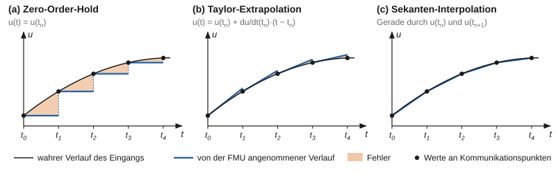

*Abbildung 1: Angenommener Eingangsverlauf innerhalb der Kommunikationsschritte: (a) Zero-Order-Hold, (b) Taylor-Extrapolation mit der Ableitung am Schrittanfang, (c) lineare Interpolation zwischen zwei bekannten Werten. Die Flächen zeigen den Fehler gegenüber dem wahren Verlauf.*

---

## 2. Die FMI-2.0-Bausteine

### 2.1 Capability-Flags in `modelDescription.xml`

Im Element `<CoSimulation>` stehen zwei Attribute:

| Attribut | Bedeutung |
|---|---|
| `canInterpolateInputs="true"` | Die FMU kann Eingänge innerhalb eines Schritts interpolieren. Ein Aufruf von `fmi2SetRealInputDerivatives()` wirkt sich also auf die Rechnung aus. |
| `maxOutputDerivativeOrder="k"` | Die FMU liefert über `fmi2GetRealOutputDerivatives()` die Zeitableitungen ihrer Ausgänge bis zur Ordnung $k$ (0 = keine Ableitungen, Default). |

Für die Test-FMUs aus Commit `64a7754`:

```xml
<CoSimulation modelIdentifier="Room"
    canHandleVariableCommunicationStepSize="true"
    canInterpolateInputs="true"
    maxOutputDerivativeOrder="1"
    canGetAndSetFMUstate="true" ... />
```

### 2.2 API-Funktionen

```c
/* Ableitungen der Ausgänge am aktuellen Kommunikationspunkt abfragen */
fmi2Status fmi2GetRealOutputDerivatives(fmi2Component c,
        const fmi2ValueReference vr[], size_t nvr,
        const fmi2Integer order[], fmi2Real value[]);

/* Ableitungen der Eingänge für den nächsten doStep setzen */
fmi2Status fmi2SetRealInputDerivatives(fmi2Component c,
        const fmi2ValueReference vr[], size_t nvr,
        const fmi2Integer order[], const fmi2Real value[]);
```

Was der Standard festlegt (FMI 2.0.5, Abschnitt 4.2.1, wörtliche Zitate in Anführungszeichen):

- **Zeitbezug der Eingangsableitungen:** „Inputs and their derivatives are set with respect to the beginning of a communication time step.“ Wert und Ableitungen, die vor `fmi2DoStep(t_n, h)` gesetzt werden, beschreiben also $u(t_n)$ und $\frac{d^k u}{dt^k}(t_n)$. Die FMU darf daraus ein Polynom für $u(t)$ im Intervall $[t_n, t_n+h]$ bilden.
- **Zeitbezug der Ausgangsableitungen:** „The returned outputs correspond to the current slave time. For example, after a successful fmi2DoStep(..) the returned values are related to the end of the communication time step.“
- **Ordnung:** In `order[]` steht 1 für die erste Ableitung, „0 is not allowed“. Werte (Ordnung 0) laufen weiterhin über `fmi2SetReal()`/`fmi2GetReal()`. Verschiedene Eingänge dürfen unterschiedliche Ordnungen haben („Different input variables may have different interpolation order.“). Der Master darf Ausgangsableitungen nur bis `maxOutputDerivativeOrder` abfragen.
- **Zu niedrige interne Ordnung:** „If the actual order is lower (because the order of integration algorithm is low), the retrieved value is 0.“ Beispiel aus dem Standard: Ist das interne Polynom erster Ordnung, liefert die FMU für die zweite Ableitung 0.
- **Einschränkungen:** Für `fmi2SetRealInputDerivatives` gelten dieselben Regeln wie für `fmi2SetReal`, für `fmi2GetRealOutputDerivatives` dieselben wie für `fmi2GetReal`. Laut Zustandstabelle (4.2.4) darf `fmi2SetRealInputDerivatives` in *instantiated*, *initializationMode* und *stepComplete* aufgerufen werden, `fmi2GetRealOutputDerivatives` nur in *stepComplete* (in anderen Zuständen nur für Debugging).
- Gemeint sind kontinuierliche Real-Eingänge („continuous real inputs“).
- Der Standard nennt neben polynomialer Inter-/Extrapolation ausdrücklich auch „more sophisticated signal extrapolation schemes like rational extrapolation“.

Was der Standard **nicht** festlegt:

- ob eingangsseitige Ableitungen nach einem `fmi2DoStep()` verfallen oder bis zum nächsten Setzen gültig bleiben,
- welche Ableitung die FMU annehmen soll, wenn der Master keine setzt. Naheliegend ist 0 (ZOH), aber vorgeschrieben ist es nicht.
- ob Eingangsableitungen zum FMU-Zustand gehören, siehe 3.2 (f).

---

## 3. Was der Co-Simulations-Master tun muss

### 3.1 Datenfluss im Überblick

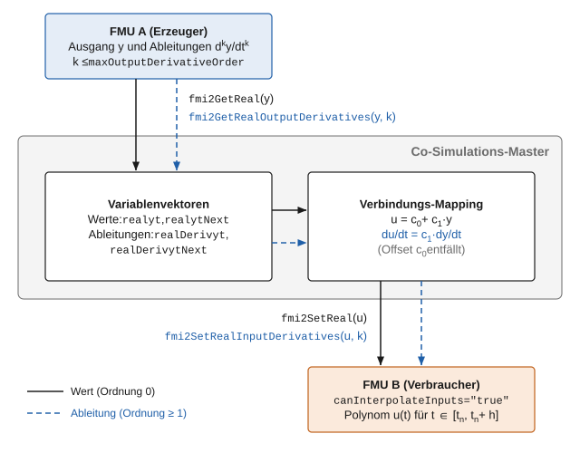

*Abbildung 2: Datenfluss von Werten (durchgezogen) und Ableitungen (gestrichelt) von FMU A über den Master zu FMU B.*

### 3.2 Schritt für Schritt

**(a) Capabilities einlesen und Ordnung festlegen**

Der Master liest beim Import für jede FMU `canInterpolateInputs` und `maxOutputDerivativeOrder`. Für jede Verbindung `A.y → B.u` gilt dann:

$$
m_{\text{conn}} =
\begin{cases}
\min\big(k_A,\ m_{\max}\big) & \text{falls } B.\texttt{canInterpolateInputs} \\
0 & \text{sonst}
\end{cases}
$$

Dabei ist $k_A$ = `maxOutputDerivativeOrder` von FMU A und $m_{\max}$ eine Master-Einstellung (meist 1, denn höhere Ordnungen bringen bei Co-Simulation selten etwas und können überschwingen). Ist $m_\text{conn}=0$, wird die Verbindung wie bisher behandelt.

Weitere Voraussetzungen: Typ `Real`, `variability="continuous"` auf beiden Seiten, und FMI 2.0 (bzw. FMI 1.0 mit `canInterpolateInputs`, wo die Funktionen analog `fmiGetRealOutputDerivatives`/`fmiSetRealInputDerivatives` heißen).

**(b) Ableitungen nach jedem Schritt holen**

Direkt nachdem `fmi2DoStep()` (oder `fmi2ExitInitializationMode()`) erfolgreich war, also dort, wo der Master heute die Ausgänge cacht, fragt er zusätzlich ab:

```c
fmi2GetReal(A, vr_y, n, y);                          // Ordnung 0
fmi2GetRealOutputDerivatives(A, vr_y, n, ord1, dy);  // Ordnung 1 (ord1[i]=1)
```

Die Ableitungen kommen in einen eigenen Vektor parallel zum Wertevektor, z.B. `m_realDerivyt` / `m_realDerivytNext` neben `m_realyt` / `m_realytNext`.

**(c) Mapping auf den Eingang, mit Kettenregel**

MasterSim erlaubt pro Verbindung eine lineare Transformation $u = c_0 + c_1\,y$ (`m_offset`, `m_scaleFactor`). Für die Ableitungen fällt der Offset weg:

$$
u = c_0 + c_1\, y \quad\Rightarrow\quad \frac{d^k u}{dt^k} = c_1\,\frac{d^k y}{dt^k}\quad (k\ge 1)
$$

Für eine nichtlineare Transformation (z.B. Einheitenumrechnung °C → K ist linear und damit unkritisch) bräuchte man die volle Kettenregel.

**(d) Werte und Ableitungen vor dem Schritt setzen**

Vor `fmi2DoStep(B, t_n, h)`:

```c
fmi2SetReal(B, vr_u, n, u);
fmi2SetRealInputDerivatives(B, vr_u, n, ord1, du);
fmi2DoStep(B, t_n, h, ...);
```

**(e) Zeitbezug je nach Algorithmus richtig wählen.** Das ist der entscheidende Punkt.

Laut Standard gelten Eingänge und ihre Ableitungen „with respect to the beginning of a communication time step“. Die Ableitung beschreibt den Eingang also **ab** $t_n$, und Wert und Ableitung müssen zum **selben Zeitpunkt** $t_n$ gehören. Daraus folgt für die Algorithmen:

| Algorithmus | Wert für B | Ableitung für B | Bemerkung |
|---|---|---|---|
| **Gauss-Jacobi** | $y_A(t_n)$ | $\dot y_A(t_n)$ | Passt direkt: Beide stammen vom Ende des vorigen Schritts. Taylor-Extrapolation ab $t_n$. |
| **Gauss-Seidel** | $y_A(t_{n+1})$ (schon berechnet) | ? | **Achtung:** Der Wert liegt bei $t_{n+1}$, die FMU erwartet aber $u(t_n)$ plus Ableitung. |
| **Newton** | wie Gauss-Seidel/-Jacobi, je nach Variante | | Die Ableitungen gehen nicht in die Jacobi-Matrix ein, sondern nur in die Eingangsbeschreibung der Slaves. |

Für Gauss-Seidel gibt es zwei saubere Optionen:

- **Option GS-1, normkonform:** Der Master setzt weiterhin $u(t_n) = y_A(t_n)$ und als Ableitung die **Sekante** über den gerade berechneten Schritt:
  $$\dot u \approx \frac{y_A(t_{n+1}) - y_A(t_n)}{h}$$
  So bekommt FMU B einen linearen Verlauf, der exakt durch beide bekannten Punkte geht. Das ist lineare **Interpolation** statt Extrapolation und gerade bei Gauss-Seidel die genaueste Variante. Die Sekante kann man mit der von A gelieferten Ableitung $\dot y_A(t_{n+1})$ zu einem Hermite-Polynom ergänzen, wenn B zweite Ableitungen annimmt.
- **Option GS-2:** $u = y_A(t_{n+1})$ setzen und $\dot y_A(t_{n+1})$ mitgeben. Das ist eine Extrapolation „vom falschen Ende“ und **nicht empfehlenswert**: Die FMU würde den Verlauf ab $t_n$ mit dem Wert von $t_{n+1}$ beginnen. Das widerspricht dem im Standard festgelegten Zeitbezug.

Hinweis: Auch ohne Ableitungen setzt Gauss-Seidel bereits heute den Wert $y_A(t_{n+1})$ als Eingang für den Schritt ab $t_n$. Der Standard verbietet das nicht, denn wie der Master Eingänge bestimmt, ist ihm überlassen. Mit Ableitungen wird der Zeitbezug aber relevant, weil die FMU das Polynom an $t_n$ verankert.

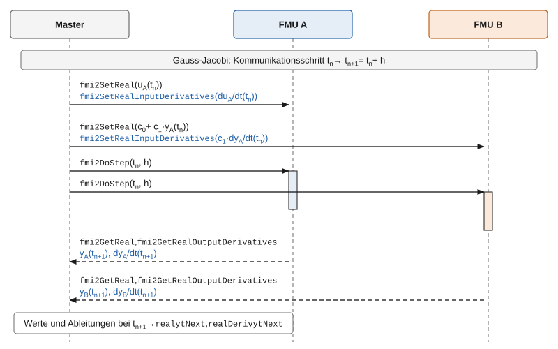

*Abbildung 3: Kommunikationsschritt mit Gauss-Jacobi: Werte und Ableitungen für FMU B stammen vom Schrittanfang $t_n$.*

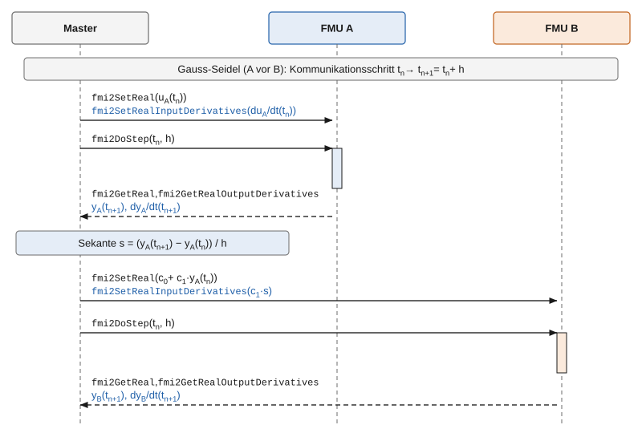

*Abbildung 4: Kommunikationsschritt mit Gauss-Seidel: Für FMU B bildet der Master aus den Werten von FMU A die Sekante über den Schritt.*

Abbildung 5 vergleicht die Optionen im Zeitverlauf.

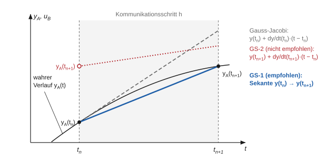

*Abbildung 5: Zeitbezug bei Gauss-Seidel: Die Sekante (GS-1) geht durch beide bekannten Werte. GS-2 verankert den Wert vom Schrittende bei $t_n$ und überschätzt den Verlauf; die Taylor-Extrapolation ab $t_n$ (Gauss-Jacobi) ist zum Vergleich gestrichelt.*

**(f) Iterationen und Rollback**

- Iteriert der Master (Gauss-Seidel/Newton mit `maxIterations > 1`), werden vor jeder Iteration die Zustände mit `fmi2SetFMUstate()` zurückgesetzt. Danach müssen **Werte und Ableitungen neu gesetzt** werden. Laut Abschnitt 2.1.8 gehören zum FMU-Zustand „all values that are needed to continue a simulation“, ausdrücklich auch „input values“. Eingangs*ableitungen* erwähnt der Standard dort nicht. Der Master sollte sich also nicht darauf verlassen, dass sie den Rollback überstehen, und sie vor jedem `fmi2DoStep()` explizit setzen, notfalls auf 0.
- Der **Konvergenztest** kann wie bisher auf den Werten bei $t_{n+1}$ laufen. Optional kann man die Ableitungen mitprüfen.
- Wiederholt der Master einen Schritt mit kleinerem $h$ (Fehlerkontrolle, `R_RETRY`), bleiben die Ableitungen bei $t_n$ gültig. Die GS-Sekante wird dagegen aus dem neuen Schritt neu berechnet.

**(g) Ausgabe und Fehlerschätzung**

Mit den Ableitungen kann der Master Ausgabewerte zwischen Kommunikationspunkten sauber interpolieren (Hermite statt linear), was für `hOutputMin` nützlich ist. Sie liefern auch einen billigen Fehlerindikator: Die Differenz zwischen extrapoliertem $y(t_n) + h\,\dot y(t_n)$ und tatsächlichem $y(t_{n+1})$ schätzt den Kopplungsfehler und kann die Schrittweitensteuerung ergänzen.

### 3.3 Gesamtablauf im Master

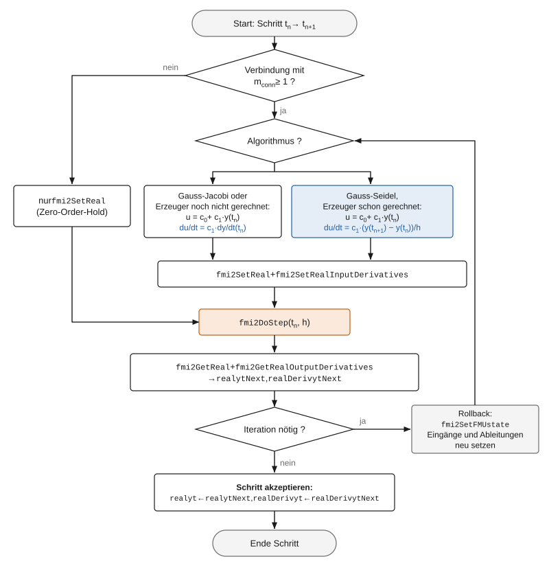

*Abbildung 6: Ablauf eines Kommunikationsschritts im Master mit Weitergabe der Ableitungen.*

---

## 4. Vorgehen aus Sicht einer FMU

### 4.1 FMU als Erzeuger: Ausgangsableitungen bereitstellen

Ziel: Nach jedem `fmi2DoStep()` soll `fmi2GetRealOutputDerivatives()` die Ableitung $\dot y(t_{n+1})$ zurückgeben, und zwar **konsistent mit dem Zustand am Kommunikationspunkt**.

Mögliche Quellen:

| Quelle | Beispiel | Qualität |
|---|---|---|
| Analytisch aus der Modellgleichung | `Room`: $\dot T = \big(Q - k\,(T - T_\text{amb})\big)/C$ | exakt, wenn die Eingänge bekannt sind |
| Kettenregel über interne Größen | `Radiator`: $\dot Q = -K_p\,\dot T_\text{room}$ (wenn nicht begrenzt) | so gut wie die Schätzung von $\dot T_\text{room}$ |
| Aus dem internen Integrator | Rückwärtsdifferenz bzw. Interpolationspolynom eines BDF/RK-Lösers | gut, keine Modellkenntnis nötig |
| Finite Differenz über den letzten Schritt | $(y_{n+1}-y_n)/h$ | grob, 1. Ordnung, um $h/2$ versetzt |

Worauf man achten muss:

- **Begrenzungen und Unstetigkeiten:** Ist der Ausgang an einer Grenze (Sättigung, Schalter), muss die Ableitung 0 sein bzw. der einseitigen Ableitung in Zukunftsrichtung entsprechen. `Radiator` macht das: Bei $Q = 0$ oder $Q = Q_\text{max}$ liefert die FMU $\dot Q = 0$.
- **Ereignisse innerhalb des nächsten Schritts** (z.B. Sollwertsprung des Thermostats) kann die Ableitung nicht vorhersehen. Die Extrapolation ist dann für diesen Schritt falsch. Abhilfe: Der Master verkleinert den Schritt, oder die FMU meldet über `fmi2GetRealStatus(fmi2LastSuccessfulTime)` bzw. `fmi2Discard` ein Problem.
- **Zustand im FMUstate mitsichern:** Alles, was zur Berechnung der Ableitung nötig ist (z.B. `m_dTdt` im Radiator), muss in `fmi2GetFMUstate`/`fmi2SerializeFMUstate` stehen, sonst liefert die FMU nach einem Rollback falsche Ableitungen.
- `maxOutputDerivativeOrder` darf nur so hoch sein, wie die FMU wirklich unterstützt. Bei höherer Ordnung `fmi2Error` bzw. `fmi2Warning` zurückgeben.

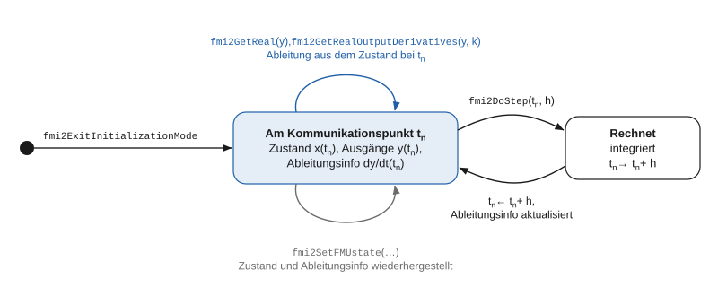

*Abbildung 7: FMU als Erzeuger: Ausgangsableitungen beziehen sich immer auf den aktuellen Kommunikationspunkt; die dafür nötigen Daten gehören zum FMU-Zustand.*

### 4.2 FMU als Verbraucher: Eingangsableitungen verwenden

**Variante A: normkonform, mit Master-gelieferten Ableitungen**

```c
fmi2Status fmi2SetRealInputDerivatives(fmi2Component c, const fmi2ValueReference vr[],
                                       size_t nvr, const fmi2Integer order[],
                                       const fmi2Real value[])
{
    for (size_t i=0; i<nvr; ++i)
        inst->m_inputDerivatives[vr[i]][order[i]] = value[i];   // gilt ab tn
    return fmi2OK;
}

fmi2Status fmi2DoStep(fmi2Component c, fmi2Real tn, fmi2Real h, fmi2Boolean noSetPrior) {
    // Eingangsfunktion u(t) = u0 + du * (t - tn) für den internen Integrator
    // ... integrieren von tn bis tn+h, dabei u(t) an jedem internen Zeitpunkt auswerten
    // danach: Eingangsableitungen auf 0 zurücksetzen (sie gelten nur für diesen Schritt)
}
```

Regeln:

1. Empfehlung, denn der Standard regelt das nicht: Die Ableitungen gelten **nur für den folgenden** `fmi2DoStep()`. Danach verwirft die FMU sie, damit ein Master, der sie im nächsten Schritt nicht setzt, sauber ZOH bekommt. Weil das nicht festgeschrieben ist, sollte ein Master sie trotzdem vor jedem Schritt setzen, siehe 3.2 (f).
2. Der interne Integrator wertet den Eingang zu jedem internen Zeitpunkt $\tau \in [t_n, t_n+h]$ als Polynom aus. Bei einer linearen ODE mit linearem Eingang geht das sogar geschlossen (siehe `Room::integrateLinear()`).
3. Physikalische Grenzen beachten: Eine extrapolierte Temperatur unter 0 K oder ein negativer Massenstrom kann bei großen $h$ entstehen. Die FMU sollte die extrapolierten Werte gegebenenfalls begrenzen.

**Variante B: FMU-interne Historie, ohne Master-Unterstützung**

Unterstützt der Master `fmi2SetRealInputDerivatives` nicht, kann die FMU die Ableitung aus den Eingangswerten der **vorigen Kommunikationspunkte** selbst schätzen. So arbeiten die beiden Test-FMUs, siehe Abschnitt 5. Diese Variante funktioniert mit jedem Master, hat aber Nachteile:

- Die FMU muss **raten**, zu welchem Zeitpunkt der gesetzte Eingangswert gehört ($t_n$ bei Gauss-Jacobi, $t_{n+1}$ bei Gauss-Seidel, wenn der Erzeuger vorher gerechnet hat). Rät sie falsch, entsteht ein Phasenfehler.
- Die Historie muss im FMUstate stehen, sonst wird sie bei Iterationen und Rollbacks verfälscht.
- Rückwärtsdifferenzen verstärken Rauschen und können Regelkreise destabilisieren (siehe 5.3).

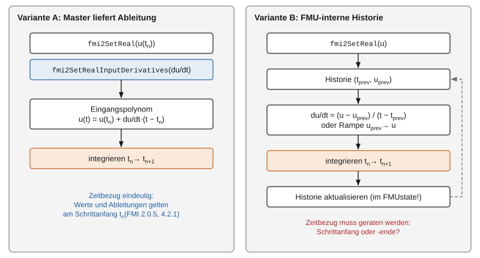

*Abbildung 8: FMU als Verbraucher: Variante A nutzt die vom Master gesetzten Ableitungen mit eindeutigem Zeitbezug, Variante B schätzt die Ableitung aus der eigenen Eingangshistorie.*

---

## 5. Die Test-FMUs `Room` und `Radiator`

### 5.1 Modelle

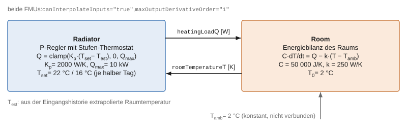

*Abbildung 9: Kopplung der Test-FMUs Radiator und Room.*

| Parameter | Room | Radiator |
|---|---|---|
| Kenngrößen | $C = 50\,000$ J/K, $k = 250$ W/K | $K_p = 2000$ W/K, $Q_\text{max} = 10$ kW |
| Sollwert | – | 22 °C (1. Tageshälfte) / 16 °C (2. Hälfte), `dayLength` = 4 h |
| `useInputInterpolation` | Rampe statt ZOH für $Q$ und $T_\text{amb}$ | Extrapolation von $T_\text{room}$ aus der Historie |
| `fmi2GetRealOutputDerivatives` | $\dot T$ analytisch aus der ODE | $\dot Q = -K_p\,\dot T_\text{room}$, 0 bei Sättigung |
| `fmi2SetRealInputDerivatives` | **No-op** (gibt `fmi2OK` zurück) | **No-op** |

Stationärer Endwert (Tagphase): $T = \frac{K_p T_\text{set} + k\,T_\text{amb}}{K_p + k} = 292{,}93$ K, $Q = 4444{,}4$ W.

### 5.2 Interne Interpolation (Variante B)

**Room**: Der gesetzte Eingang $Q$ wird als Wert am **Schrittende** gedeutet. Die FMU legt eine Rampe vom Wert des vorigen Schritts zum aktuellen und integriert die lineare ODE geschlossen:

$$
T(t_n+h) = T_n e^{-\lambda h} + a_0 h \frac{1-e^{-\lambda h}}{\lambda h} + a_1 \frac{h}{\lambda}\Big(1 - \frac{1-e^{-\lambda h}}{\lambda h}\Big),\quad \lambda = k/C
$$

Das passt zu **Gauss-Seidel mit der Reihenfolge Radiator → Room**: Dort hat der Radiator $Q(t_{n+1})$ schon berechnet. Bei **Gauss-Jacobi** bekommt Room dagegen $Q(t_n)$ und interpoliert von $Q(t_{n-1})$ nach $Q(t_n)$, also um einen ganzen Schritt verzögert.

**Radiator**: Der gesetzte Eingang $T_\text{room}$ wird als Wert am **Schrittanfang** gedeutet und linear bis $t_{n+1}$ extrapoliert:

$$
T_\text{est}(t_{n+1}) = T_n + \frac{T_n - T_{n-1}}{t_n - t_{n-1}}\, h
$$

Daraus berechnet die FMU $Q_{n+1} = K_p\,(T_\text{set}(t_{n+1}) - T_\text{est})$, wobei $T_\text{est}$ die extrapolierte Raumtemperatur ist.

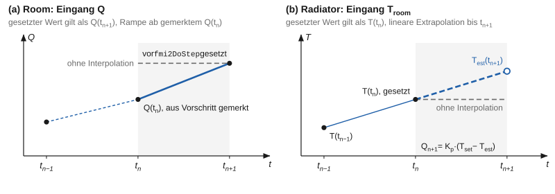

*Abbildung 10: Deutung der gesetzten Eingänge in den Test-FMUs: (a) Room legt eine Rampe vom gemerkten $Q(t_n)$ zum gesetzten Wert, den es als $Q(t_{n+1})$ deutet; (b) Radiator extrapoliert die Raumtemperatur aus den letzten beiden Kommunikationspunkten.*

Beide FMUs nehmen damit implizit eine bestimmte Master-Reihenfolge an. Die Deutung im Room-FMU (gesetzter Wert = Wert am Schrittende) passt nicht zur Festlegung im Standard, nach der Eingänge „with respect to the beginning of a communication time step“ gesetzt werden. Für die FMU-interne Historie (Variante B) ist das zulässig, weil der Standard nur die Bedeutung der Ableitungen regelt. Sobald Room `fmi2SetRealInputDerivatives` auswertet, muss es aber den Anfangsbezug verwenden. Mit normkonformem `fmi2SetRealInputDerivatives` (Variante A) wäre der Zeitbezug eindeutig, und der Master würde über Abschnitt 3.2 (e) entscheiden.

### 5.3 Testfälle in `data/tests/linux64/Room_Radiator/`

| Testfall | Algorithmus | $h$ | $t_\text{end}$ | Interpolation |
|---|---|---|---|---|
| `Room_Radiator_Reference` | Gauss-Seidel, 1 Iter. | 5 s | 14 400 s | an |
| `Room_Radiator_GaussSeidel_1iters` | Gauss-Seidel, 1 Iter. | 30 s | 28 800 s | an |
| `Room_Radiator_NoInterpolation_GaussSeidel_1iters` | Gauss-Seidel, 1 Iter. | 30 s | 28 800 s | **aus** |
| `Room_Radiator_GaussSeidel_2iters` | Gauss-Seidel, 2 Iter. | 60 s | 14 400 s | an |
| `Room_Radiator_GaussJacobi_1iters` | Gauss-Jacobi, 1 Iter. | 60 s | 14 400 s | an |

**Beobachtung aus den eingecheckten Referenzergebnissen** (Ausschnitt, $h = 30$ s):

| t [s] | Q mit Interpolation [W] | Q ohne Interpolation [W] | Q Referenz, h = 5 s [W] |
|---|---|---|---|
| 120 | 6128 | 10000 | 6354 |
| 150 | 4125 | 3905 | 4972 |
| 300 | 5045 | 4445 | ≈ 4444 |
| 330 | 2766 | 4444 | ≈ 4444 |
| 360 | 5365 | 4444 | ≈ 4444 |
| 840 | 5815 | 4444 | ≈ 4444 |

Abbildung 11 zeigt den Verlauf für die ersten 900 s.

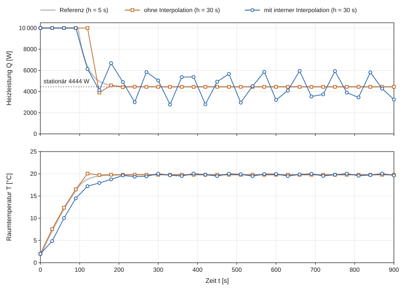

*Abbildung 11: Heizleistung und Raumtemperatur für $t \le 900$ s aus den eingecheckten Ergebnissen: Gauss-Seidel mit $h = 30$ s mit und ohne FMU-interne Interpolation, dazu die Referenzlösung mit $h = 5$ s.*

Die Variante **mit** interner Interpolation schwingt dauerhaft zwischen etwa 2800 und 6000 W. Die Variante **ohne** Interpolation pendelt sich nach wenigen Schritten auf den stationären Wert ein. Woran das liegt:

- Die Regelschleife ist für $h = 30$ s sehr „steif“: $K_p h / C = 1{,}2$. Der Kommunikationsschritt ist also ungefähr so lang wie die Zeitkonstante des geschlossenen Kreises ($C/(K_p+k) \approx 22$ s).
- Die Rückwärts-Extrapolation im Radiator wirkt wie ein zusätzlicher D-Anteil: $Q_{n+1} = K_p\,(T_\text{set} - 2T_n + T_{n-1})$. Die jüngste Änderung geht doppelt ein. Das verringert die Phasenreserve, und der Kreis schwingt.
- Bei $h = 60$ s (Gauss-Jacobi, Gauss-Seidel mit 2 Iterationen) ist $K_p h/C = 2{,}4$. Dort laufen die Ergebnisse stark in die Begrenzung $[0, Q_\text{max}]$.

Fazit: **Extrapolation ist kein Selbstläufer.** Sie bringt eine höhere Konsistenzordnung, kann aber die Stabilität der Kopplung verschlechtern, sobald $h$ in der Größenordnung der Kopplungs-Zeitkonstante liegt. Genau hier hilft ein Master, der die **richtigen** Informationen weiterreicht: bei Gauss-Seidel die Sekante zwischen zwei bereits berechneten Punkten (Interpolation, stabil) statt einer Rückwärts-Extrapolation in der FMU.

> Hinweis zu den Testfällen: Die Referenzlösung läuft bis 14 400 s mit $h = 5$ s. Die beiden 30-s-Fälle laufen bis 28 800 s, die übrigen mit $h = 60$ s. Für einen quantitativen Fehlervergleich sollten $t_\text{end}$ und das Ausgaberaster vereinheitlicht werden.

---

## 6. Stand in MasterSim und Implementierungsschritte

### 6.1 Ist-Zustand

| Baustein | Stand |
|---|---|
| `canInterpolateInputs` einlesen | ✅ `MSIM_ModelDescription.cpp:190` → `m_canInterpolateInputs` |
| `maxOutputDerivativeOrder` einlesen | ❌ wird nicht gelesen |
| Funktionszeiger importieren | ✅ `MSIM_FMU.cpp:342-343` (`setRealInputDerivatives`, `getRealOutputDerivatives`) |
| Ableitungen abfragen/weiterreichen | ❌ keine Aufrufe in `MSIM_FMUSlave` oder den Algorithmen |
| Test-FMUs | ✅ `Room`, `Radiator` liefern Ausgangsableitungen; Eingangsinterpolation nur FMU-intern (Variante B) |

Die Test-FMUs funktionieren also im Moment **ohne** Master-Unterstützung. Ihre Ausgangsableitungen werden noch von niemandem abgefragt.

### 6.2 Vorgeschlagene Schritte

1. **`MSIM_ModelDescription`**: `int m_maxOutputDerivativeOrder` aus `<CoSimulation>` lesen (Default 0). Für FMI 1.0 aus `<Capabilities>`.
2. **`MSIM_AbstractSlave` / `MSIM_FMUSlave`**:
   - neuer Vektor `std::vector<double> m_doubleOutputDerivatives` (Ordnung 1),
   - `cacheOutputs()` ruft zusätzlich `getRealOutputDerivatives` auf, wenn `maxOutputDerivativeOrder >= 1`,
   - neue Methode `setRealInputDerivative(unsigned int vr, int order, double value)`.
   - `FileReaderSlave`: Die Ableitung lässt sich direkt aus dem linearen Spline bestimmen (Steigung des aktuellen Segments). Das ist eine kostenlose Ableitungsquelle.
3. **`MSIM_MasterSim`**:
   - parallele Vektoren `m_realDerivyt`, `m_realDerivytNext` (und `...NextIter` beim Iterieren),
   - `VariableMapping` um `int m_derivativeOrder` erweitern (siehe 3.2 a),
   - `syncSlaveOutputs()` kopiert auch die Ableitungen,
   - `updateSlaveInputs()` setzt zusätzlich die Ableitungen, skaliert mit `m_scaleFactor` und mit dem Zeitbezug je Algorithmus (3.2 e). Für Gauss-Seidel braucht die Funktion dazu sowohl `realyt` als auch `realytNext`.
   - `storeState()`/`restoreState()` und die Übernahme des Schritts (`realyt ← realytNext`) um die Ableitungsvektoren ergänzen.
4. **Projektoption** in `MSIM_Project`, z.B. `interpolateInputs yes|no` und `maxInputDerivativeOrder 1`, damit man vergleichen kann und alte Testergebnisse reproduzierbar bleiben.
5. **Test-FMUs** auf Variante A umstellen oder um sie erweitern: `fmi2SetRealInputDerivatives` wirklich auswerten, mit einem Parameter, der zwischen „Master-Ableitung“, „interne Historie“ und „ZOH“ umschaltet. Dann lassen sich alle drei Varianten mit denselben FMUs vergleichen.
6. **Neue Testfälle**: dieselben Szenarien mit Master-seitiger Interpolation, einheitliches $t_\text{end}$, und eine Referenz mit sehr kleinem $h$ für die Fehlerauswertung.

---

## Anhang: Kurzreferenz

```
Erzeuger-FMU                        Master                              Verbraucher-FMU
─────────────                       ──────                              ───────────────
fmi2DoStep(tn-1, h) ──► y(tn), ẏ(tn)
                     fmi2GetReal ──►  y(tn)
   fmi2GetRealOutputDerivatives ──►  ẏ(tn)
                                      u  = c0 + c1·y      (GJ: y(tn))
                                      u̇  = c1·ẏ            (GS: Sekante)
                                      ──► fmi2SetReal(u)
                                      ──► fmi2SetRealInputDerivatives(u̇)
                                                                     u(t)=u+u̇·(t−tn)
                                      ──► fmi2DoStep(tn, h)          integrieren
```

**Literatur**

- *Functional Mock-up Interface for Model Exchange and Co-Simulation*, Version **2.0.5** (26.11.2024, aktuelle 2.0.x-Fassung; lokal: `doc/FMI_specs/FMI-Specification-2.0.5.pdf`, Download: https://github.com/modelica/fmi-standard/releases/download/v2.0.5/FMI-Specification-2.0.5.pdf). Relevante Abschnitte:

  | Abschnitt | Thema | Seite 2.0.5 | Seite 2.0 (`doc/FMI_specs/…_v2.0.pdf`) |
  |---|---|---|---|
  | 2.1.8 Getting and Setting the Complete FMU State | Umfang des FMU-Zustands | 25 | 24 |
  | 4.1.2 Mathematical Model (Table 2) | Set $u(t_i)$, $u^{(j)}(t_i)$ → `fmi2DoStep` → Get $y^{(j)}(t_{i+1})$ | 101 | 96 |
  | 4.2.1 Transfer of Input / Output Values and Parameters | `fmi2SetRealInputDerivatives`, `fmi2GetRealOutputDerivatives` | 104 | 99 |
  | 4.2.4 State Machine of Calling Sequence from Master to Slave | erlaubte Zustände der Aufrufe | 108 | 103 |
  | 4.3.1 Co-Simulation FMU (CoSimulation) | `canInterpolateInputs`, `maxOutputDerivativeOrder` | 113 | 108 |

  Im Abschnitt 4.2.1 sind beide Fassungen inhaltlich gleich. Nur in 2.0 steht noch der Verweis auf das Begleitdokument „FunctionalMockupInterface-ImplementationHints.pdf“. Das Changelog von 2.0.1 bis 2.0.5 enthält keine Änderungen an diesen Funktionen oder Attributen.
- Busch, M.: *Zur effizienten Kopplung von Simulationsprogrammen*, Kassel University Press, 2012 (Konsistenz- und Stabilitätsanalyse von Kopplungsverfahren mit Extrapolation).
- MasterSim Algorithmenbeschreibung: `doc/algorithm/Algorithms.pdf`.
